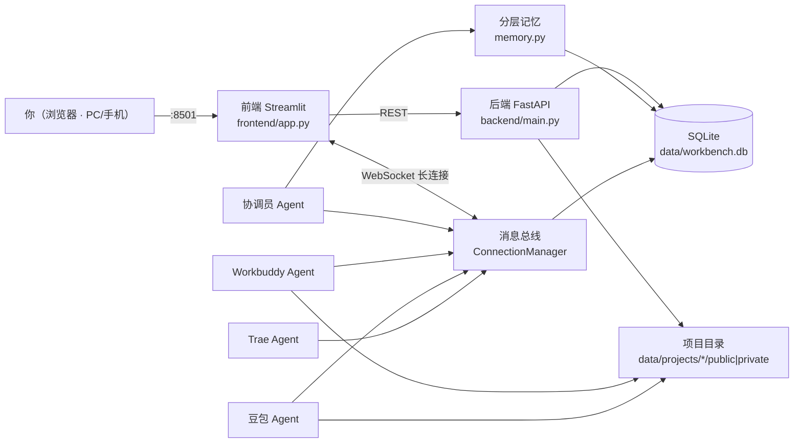
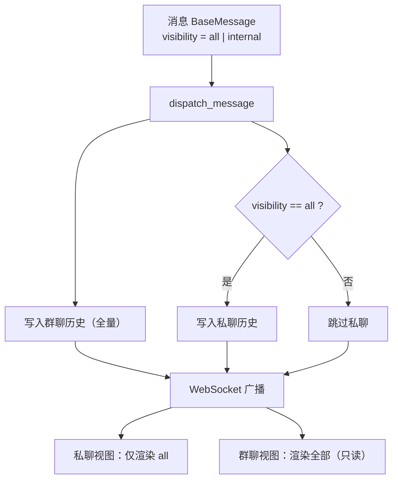
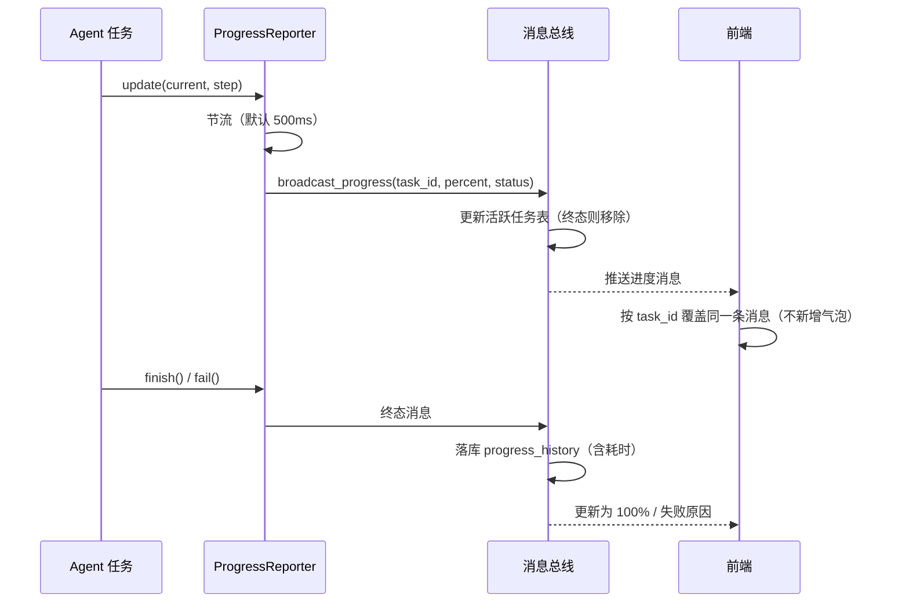
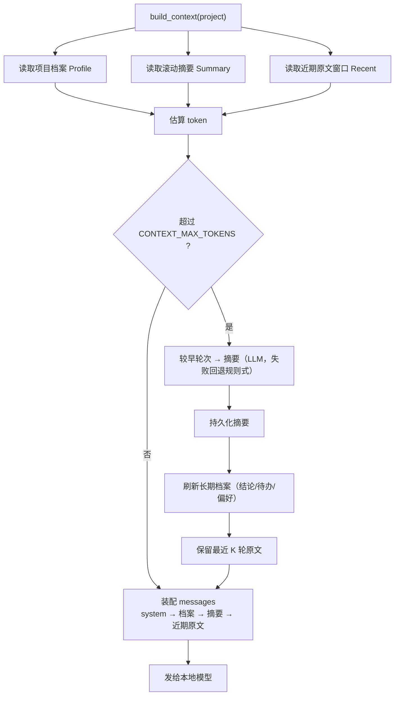

# 架构说明

## 1. 总体架构

- 前端与后端分离：前端只做渲染与交互，状态与数据全在后端。
- 消息统一从总线出口（`bus.py`）发出：**先落库，再广播**，保证历史与实时一致。
- 所有数据落在本地 `data/`，不经过任何第三方服务器。

## 2. 双视图与消息分级

协调员对每条消息标记可见性：`all`（私聊 + 群聊）或 `internal`（仅群聊）。

- 用户永远只能与协调员对话，无法在内部群直接发言。
- 两个视图读同一份数据，实时同步；切换项目时两视图一起切换。

## 3. 进度上报与原地更新

要点：

- 同一任务在群里**只有一条**进度消息，更新时原地刷新，不刷屏。
- 前端重连时通过活跃任务表补齐所有进行中任务的当前进度。
- 新增 Agent 只需调用 `ProgressReporter`，前端无需改动。

## 4. 分层记忆与上下文压缩

- 三层记忆：长期档案（跨会话）、中期摘要、近期原文。
- 前缀（`system + 档案 + 摘要`）内容与顺序稳定，便于推理服务命中前缀 KV 缓存。
- 前端「协调员记忆（可编辑）」面板可查看、修正、清空长期记忆。

## 5. 关键设计取舍

| 决策 | 原因 |
|---|---|
| 消息统一走 `bus.py` 出口 | 落库与广播顺序可控，避免历史/实时不一致 |
| 进度按 `task_id` 原地更新 | 长任务不刷屏，多个任务并行时各自独立 |
| 前端按 `visibility` 过滤而非后端分库返回 | 两个视图共享一份数据，切换零延迟 |
| 外部 Agent 未配置时回退本地实现 | 无依赖即可跑通完整链路，便于验证与二次开发 |
| 记忆分三层而非无限长上下文 | 在有限上下文窗口下兼顾远期脉络与近端精确 |
